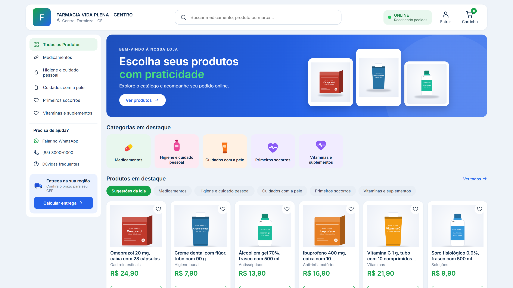
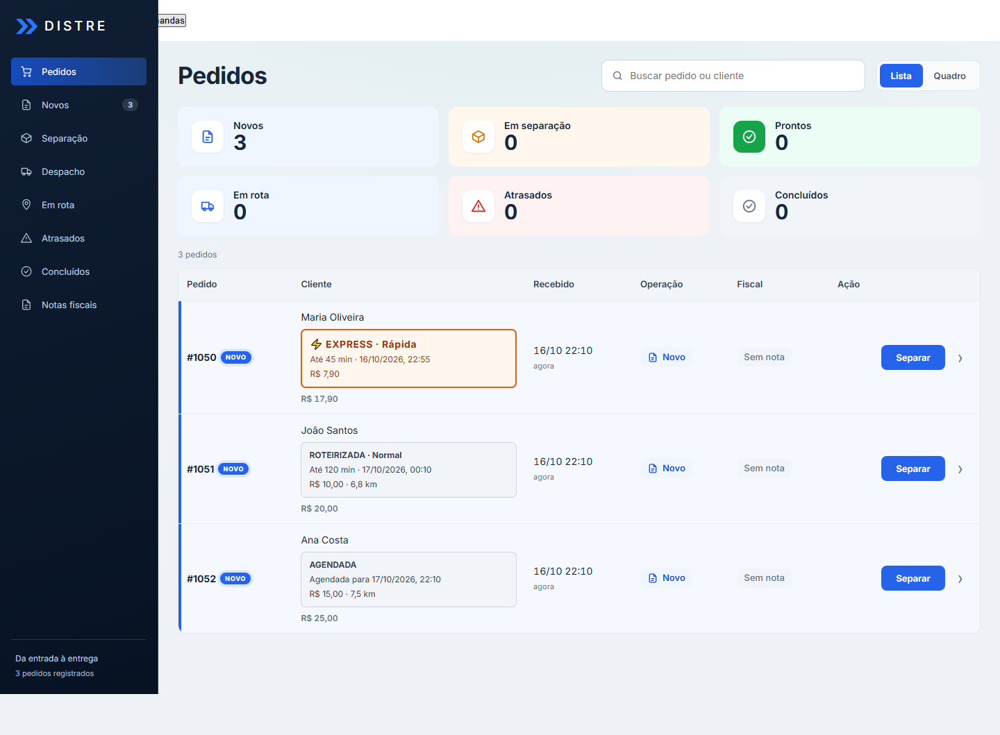
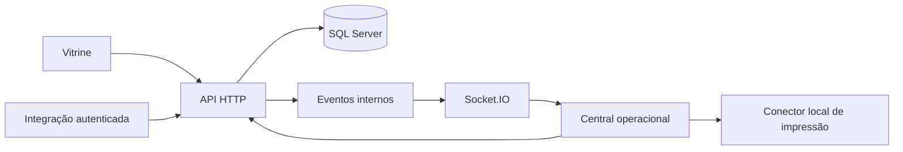

# Distre — operação de pedidos e entregas

Projeto de portfólio desenvolvido do zero para conectar catálogo, estoque, separação e entrega em uma aplicação funcional. O objetivo é demonstrar conhecimento técnico e operacional. Este repositório não constitui uma oferta comercial.

**Situação em 28/10/2026:** fase final de desenvolvimento do escopo operacional atual. As entregas são geridas manualmente pela central. A descrição abaixo corresponde aos módulos implementados; recursos externos dependem da configuração e das validações indicadas.



## O que funciona no escopo atual

| Área | Recursos implementados |
| --- | --- |
| Vitrine e catálogo | Identidade por loja, categorias, produtos e imagens, destaques, busca, detalhes do produto, sacola e finalização do pedido. |
| Produtos | Cadastro, importação, publicação no catálogo, código interno, EAN e campos fiscais. |
| Estoque | Controle por loja e por produto, entradas, saídas, ajustes, saldos, mínimos e movimentações vinculadas aos pedidos. |
| Separação | Conferência por EAN, quantidades por unidade, indicação de falta e conclusão da separação. |
| Pedidos | Lista e quadro por etapas, busca, paginação, detalhes e atualização do painel por Socket.IO. |
| Despacho | Seleção de pedidos, vinculação a entregador e ordem definida pelo operador, incluindo despacho em lote. |
| Entregas | Acompanhamento de status pela central, finalização, registro de insucesso e recebimento integral de retorno vendável ao estoque. |
| Documentos operacionais | Comanda para impressão e download em PDF; seleção de impressoras e impressão automática com conector Windows local. |
| Administração | Empresas e lojas, sessões administrativas e de loja, isolamento de acesso e acompanhamento da operação. |
| Relatórios | Pedidos, valores registrados, ticket médio, produtos, estoque e análises por loja/período, com exportação CSV e avisos de cobertura dos dados. |
| Cobranças da plataforma | Faturas, assinaturas, inadimplência, regras de acesso e Pix com confirmação manual pelo administrador. Não representa o financeiro das vendas da loja. |
| Implantação | Jornada em sete etapas, progresso por loja, verificação de tarefas, vídeos, manuais e modelos de importação. |
| API de integração | Ingresso de pedidos e entregas, autenticado por chave da loja. |



## Exemplo de fluxo operacional

1. A loja cadastra ou importa os produtos e configura estoque e catálogo.
2. O cliente monta a sacola e informa seus dados e endereço.
3. O servidor valida os itens e os dados do pedido antes de registrá-lo.
4. O pedido entra na central; o operador separa e confere as unidades por EAN.
5. A separação concluída gera uma entrega vinculada à venda, sem duplicá-la ao repetir a solicitação.
6. O operador seleciona pedidos e entregador e registra o despacho.
7. A central registra conclusão ou insucesso. No retorno integral vendável, o recebimento físico confirmado permite estornar a saída e encerrar o retorno.

Os dados do pedido ficam preservados ao gerar a entrega vinculada.

## Decisões técnicas

- **Frontend:** React, TypeScript, Vite e CSS/Tailwind. Vitrine, operação e área de implantação têm carregamento separado.
- **Backend:** Node.js, TypeScript e Express, com API HTTP e Socket.IO.
- **Persistência:** SQL Server, com driver nativo Windows ou `tedious` selecionado por configuração.
- **Eventos:** broker interno baseado em `EventEmitter`, com automações para despacho, monitoramento de estados e integrações. Esses componentes executam regras de negócio.
- **Consistência:** transações no ciclo pedido → entrega → retorno, controle de concorrência e regressões de repetição de ações, falhas de persistência e isolamento por loja.
- **Acesso:** sessões com expiração, verificação de loja em HTTP/Socket e chave própria nas APIs de integração.
- **Impressão:** PDFKit no backend e conector Windows separado, acessível apenas localmente e com origens autorizadas.
- **Testes:** Vitest; cenários de API HTTP/Socket e suítes opt-in com SQL Server real em bases temporárias.

O broker e parte dos caches/cotações ficam em memória. A presença de suporte a Redis para Socket.IO não comprova consistência completa entre múltiplas instâncias.



## Fiscal e serviços externos

Há módulo fiscal com configuração por loja, provedor simulado e adaptadores Focus NFe e SEFAZ direta, além de consulta de situação e documentos. Testes com simulação e SQL não comprovam autorização real de NF-e/NFC-e. Emissão real depende de certificado, credenciais, configuração tributária e homologação adequada. A operação pode despachar sem emitir nota no Distre, conforme o fluxo configurado.

O adaptador Asaas existe no código, mas sua presença não comprova processamento de cobrança real. A cobrança Pix demonstrada na Área do Cliente usa confirmação manual do administrador.

ViaCEP auxilia o preenchimento do endereço. ArcGIS/Nominatim e OSRM são usados no cálculo por distância. Quando o número não é localizado, a interface pode informar estimativa até um ponto do logradouro; indisponibilidade e localização insuficiente podem impedir a cotação.

APIs de ingresso estão implementadas. Não se declara integração pronta com um ERP, aplicativo Linx ou WhatsApp de produção sem o respectivo conector e aceite operacional.

## Limites do projeto

O escopo atual não inclui aplicativo ativo do entregador, telemetria/GPS, mapa de acompanhamento, cerca virtual, captura real de foto/assinatura nem operação mobile offline. Há código histórico e simulações restritas ao desenvolvimento; não são apresentados como ferramentas da operação em uso.

Compras, contas a pagar/receber das vendas da loja, conciliação bancária, custo/margem contábil, retorno parcial/avariado e permissões individuais por operador não estão concluídos. Relatórios de pedidos não certificam caixa, receita contábil ou margem.

O projeto não tem escala multi-instância, disponibilidade contínua, emissão fiscal real ou funcionamento de toda impressora física certificados. Consulte o [status e as verificações atuais](docs/STATUS_ATUAL.md) para os resultados e seus limites.

## Executar localmente

Requisitos: Node.js 22.12+ da linha 22, Node.js 24 ou versão posterior suportada; npm; SQL Server acessível com banco exclusivo previamente criado. O caminho nativo Windows requer ODBC/driver compatível; em Linux utilize `DB_DRIVER=tedious` com autenticação SQL.

```powershell
npm ci
npm ci --prefix backend
npm ci --prefix frontend
Copy-Item backend/.env.example backend/.env
```

Ajuste o arquivo privado `backend/.env` com o servidor e nome do banco, autenticação e credenciais administrativas. Use um banco próprio de desenvolvimento. Não há senha administrativa padrão para novos bancos. Mantenha `SEED_DEMO=false` e `ENABLE_SIMULATOR=false` para trabalhar sem dados ou simulações de demonstração.

```powershell
npm run dev
```

O backend usa a porta 5000 por padrão. O frontend de desenvolvimento informa a URL ao iniciar. No build servido pelo backend, a operação fica em `/app`, a vitrine em `/loja/<lojaId>` e a área da loja em `/area-cliente`. A implantação requer sessão.

```powershell
npm run build
npm test --prefix backend
```

Os testes SQL são opt-in e criam bancos temporários próprios; exigem instância local de testes com permissão para criar/remover esses bancos. Nunca os aponte para o banco de operação. Instruções e resultados: [status atual](docs/STATUS_ATUAL.md).

## Estrutura e documentação

- `frontend/src/cliente/`: vitrine, sacola e finalização.
- `frontend/src/components/`: operação e administração.
- `frontend/src/implantacao/`: Área do Cliente e preparação.
- `backend/src/`: API, persistência, estoque, pedidos e entregas.
- `backend/src/billing/` e `backend/src/fiscal/`: cobranças e fiscal.
- `backend/test/`: testes automatizados.
- `gestor-desktop/print-bridge/`: [conector local de impressão](gestor-desktop/print-bridge/README.md).
- [Estoque](backend/docs/estoque.md) e [conferência EAN](backend/docs/conferencia-ean.md).
- [Estado atual e validação](docs/STATUS_ATUAL.md).

Documentos datados em `backend/docs/` registram decisões e auditorias anteriores. Algumas restrições foram alteradas depois; para a apresentação atual prevalecem este README e o status de 28/10/2026. As imagens deste README usam dados fictícios de demonstração.
